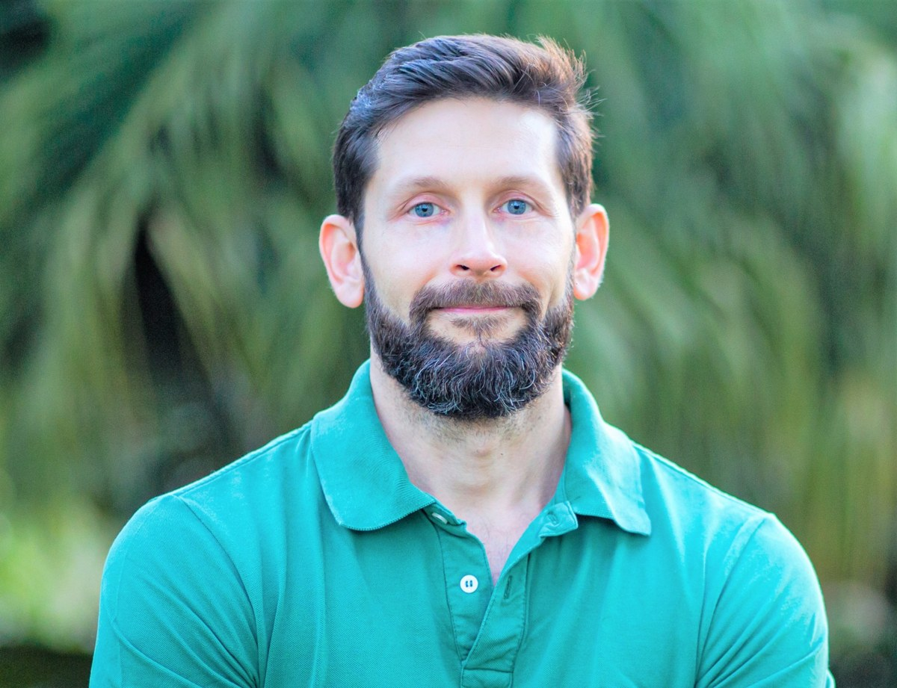

{width="300px" fig-align="left" style="float:right; margin: 0 0 1rem 1.5rem; border-radius: 10px;"}

I am an Argentinean ecologist working on **conservation ecology, conservation biogeography, and spatial models**.

I graduated in **Forest Engineering** from the National University of Misiones, Argentina (2010), where I was distinguished as an Outstanding Graduate of the Faculty of Forestry Sciences. I then earned a **Master's (2014)** and a **Ph.D. (2018)** in Forest Engineering, in the nature conservation research line, at the Federal University of Paraná, Brazil. 

I was a postdoctoral researcher at the Subtropical Biology Institute (UNaM–CONICET, Argentina; 2018–2021) and at the University of California, Riverside (USA; 2021–2022), supported by the U.S. National Science Foundation. Today I work as a **Researcher at the Subtropical Biology Institute (CONICET–UNaM, Argentina)** and as a **Research Scientist at the Center for Open Geographical Science, San Diego State University (USA)**.

I have supervised students and taught courses in graduate programs in Argentina and Brazil, and I co-lead the EcoCode working group on biodiversity modelling.

## Positions

| Period | Position | Institution |
|:------------------|:----------------------|:-----------------------------|
| 2024 – present | Research Scientist | Center for Open Geographical Science (COGS), San Diego State University, USA |
| 2022 – present | Assistant Researcher | Subtropical Biology Institute (IBS), CONICET – National University of Misiones, Argentina |
| 2021 – 2025 | Affiliate Professor | Graduate Program in Neotropical Biodiversity (PPGBN), Federal University of Latin American Integration (UNILA), Brazil |
| 2021 – 2022 | Postdoctoral Researcher (NSF) | University of California, Riverside, USA — supervisor: Janet Franklin |
| 2018 – 2021 | Postdoctoral Researcher (CONICET) | Subtropical Biology Institute (IBS), CONICET – UNaM, Argentina — supervisors: Paulo De Marco Jr. and Héctor A. Keller |

## Education

| Year | Degree | Institution |
|:-----------------|:--------------------|:--------------------------------|
| 2014 – 2018 | Ph.D. in Forest Engineering | Federal University of Paraná (UFPR), Brazil |
| 2012 – 2014 | M.Sc. in Forest Engineering | Federal University of Paraná (UFPR), Brazil |
| 2003 – 2010 | Forest Engineer | National University of Misiones (UNaM), Argentina |

## *Ad honorem* service

- **2023 – present** — Co-leader, [EcoCode working group on biodiversity modelling](https://geobon.org/ecocode-modelling-life-on-earth/) (GEO BON).
- **2014 – present** — Full member, [Sociedade Chauá](https://www.sociedadechaua.org/en/quem-somos) (Brazil).
- Session and symposium organizer: *Overcoming challenges in biodiversity modelling* (Living Data 2025, Bogotá) and *Advances in Biodiversity Modeling from Monitoring to Mitigation* (GEO BON 2023, Montreal).
- Peer reviewer for many journals — see my [Web of Science reviewer record](https://www.webofscience.com/wos/author/record/1938011).

## Awards

- **2022** — GBIF Ebbe Nielsen Challenge (for the *bdc* R package).
- Outstanding Graduate, Faculty of Forestry Sciences, National University of Misiones.

[Download my full CV (PDF)](files/CV_Velazco_Santiago.pdf){.btn .btn-primary}
